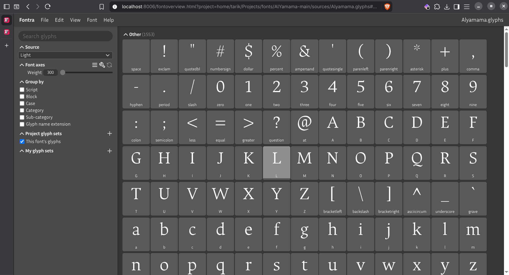

# Fontra Flatpak
## Flatpak repository for Fontra



### Key Features

* **Supported File Formats:**
  * **Read & Write:** Fontra (`.fontra`), Unified Font Object (`.ufo`), DesignSpace (`.designspace`), and RoboFont Component Format (`.rcjk`).
  * **Partial Read & Write:** Glyphs (`.glyphs`, `.glyphspackage`).
  * **Read-Only (Import):** TrueType (`.ttf`), OpenType (`.otf`), WOFF (`.woff`), WOFF2 (`.woff2`), and TTX XML (`.ttx`).
* **Variable Font Native:** Designed from the ground up for multi-axis variable font design, interpolation, and axis management.
* **Modern Vector Editing:** Non-destructive path operations, full component support, custom anchors, and multi-layer editing.
* **Text Shaping & Live Preview:** Real-time text shaping engine with OpenType feature testing.
* **Extensible & Web-Native:** Runs seamlessly in the browser or as a standalone local application via Flatpak.

### Installation

* If Flatpak is not already enabled on your Linux distribution, follow [these instructions](https://flatpak.org/setup/) for your distribution to enable it.
* If Flatpak is integrated with your Software Center (as in Fedora Workstation or Manjaro), download [`xyz.fontra.FontraPak.flatpakref`](https://fontra.github.io/fontra-flatpak/xyz.fontra.FontraPak.flatpakref), right-click it, and select **Open with -> Software Install**.
* Otherwise, copy and paste the following command into your terminal:

```bash
flatpak install --from https://fontra.github.io/fontra-flatpak/xyz.fontra.FontraPak.flatpakref
```
* Type Y for yes and provide your password when prompted
* FontraPak with all its dependencies will be installed on your computer

### Update

* If FontraPak is showing in your Software Centre, you can press the "Update" button to update to the latest version.
* Otherwise, open your terminal and type
```bash
flatpak update xyz.fontra.FontraPak
```
### Running FontraPak

* In terminal, start the application by typing
```bash
flatpak run xyz.fontra.FontraPak
```
* Alternatively, open your app menu and click on the FontraPak icon 

### Developer

#### Building the Flatpak

Requires `flatpak-builder`, plus the Freedesktop runtime and SDK 25.08:

```bash
flatpak install flathub org.freedesktop.Platform//25.08 org.freedesktop.Sdk//25.08
flatpak-builder --user --install --force-clean build-dir xyz.fontra.FontraPak.yml
```

Run the app from the build directory without installing it:

```bash
flatpak-builder --run build-dir xyz.fontra.FontraPak.yml fontrapak
```

#### Notes

* The manifest packages the prebuilt Ubuntu release archive (`FontraPak-Ubuntu.tgz`), not a build from source.
* The desktop entry, MIME definitions (`xyz.fontra.FontraPak.xml`), and metainfo are installed from this repository.
* When you bump the release, update both the `url` and `sha256` for the archive in `xyz.fontra.FontraPak.yml`.  

### Known Issues

**Performance:** The Flatpak build uses the Ubuntu 22.04 binary, so it does not run as fast as a Flatpak built from source. Planned work on this is tracked in the [Roadmap to Fontra Flatpak](https://github.com/fontra/fontra-flatpak/issues/1).

---

### Reporting Issues

* **Flatpak packaging or runtime issues:** Open an issue on [fontra-flatpak/issues](https://github.com/fontra/fontra-flatpak/issues).
* **General Linux bugs or application crashes:** Open an issue on [fontra-pak/issues](https://github.com/fontra/fontra-pak/issues).
